# Welcome and overview {.transition-slide}

## Plan for today {.smaller}

:::: {.columns}
::: {.column}

| Time | Topic |
|------|-------|
| *0:00* | *Welcome and overview* |
| 0:15 | Reproducibility and collaboration with GitHub |
| *0:55* | *Break* |
| 1:00 | Publications and software |
| *1:55* | *Break* |
| 2:00 | AI in the research workflow |
| 2:30 | Data visualisation |
| *3:00* | *Wrap-up* |
| *3:15* | *Finish* |

:::
::: {.column}

🕰️ In this session, we will cover:

- Structuring a research project
- Git basics: commit, push, pull, handling merge conflicts
- Pull requests, issues and co-authors 

I'm hoping that you can follow along with me! That way, you can do and practise what I'm talking about. 

*There are several short hands-on activities. Work with a partner for any or all of these.*

<br>
[**Feel free to ask questions.** 🙋🏾]{.hover-bounce}

:::
::::

## Workshop philosophy

Materials are based on what I find useful in my daily work as an academic. 

::: {.f80}

- The goal is to get us all up and running by the end of the workshop
- If you run into small (but critical) errors, they might need to be solved later
- Provide insight into how to implement this workflow
- Practise small examples, to check that you can work this way
- After the workshop, to retain what you've learned you'll need to [practise, practise, practise]{.rn-fragment rn-type=circle rn-color=#e78c45 rn-strokewidth=3 rn-padding=12}!

:::

## Illustration of the toolbox

{width="80%"}

## Working with graduate students

::: {.panel-tabset}

## Student

::: {.column width="60%"}

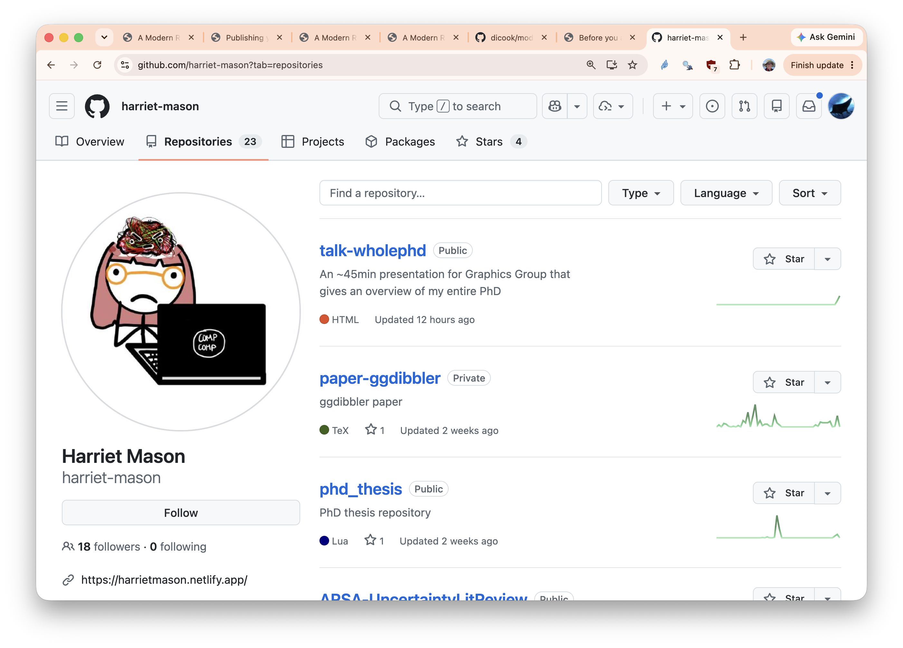{width="100%"}

:::
::: {.column width="40%"}

::: {.f70}
- Student creates GitHub repo for particular projects
- Initially private, with access for just the student and advisor
- One of the projects might be a progress report, which could be a series of blog posts documenting weekly updates
- We also have a channel in our Slack organisation where we can communicate instantly with each other
:::

:::

## Project

::: {.column width="60%"}

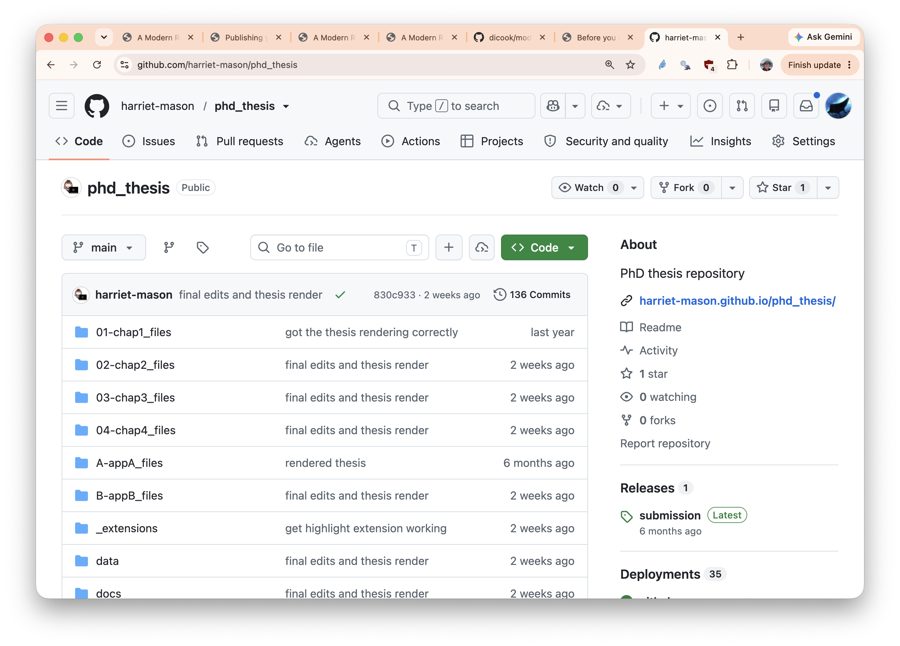{width="100%"}

:::
::: {.column width="40%"}

::: {.f70}
- The work is version controlled. We can always backtrack, obtain previous versions, map out the different directions a project takes
- Advisors can easily see and check work regularly
- Advisors can actively collaborate
- If the student's computer has problems, the work is preserved
:::
:::

## Feedback

::: {.column width="60%"}

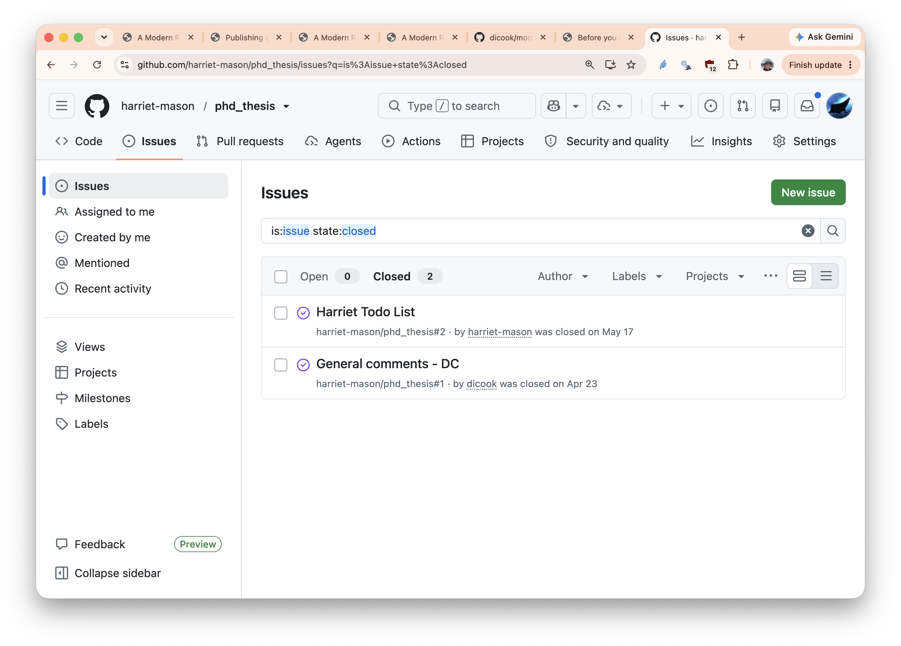{width="100%"}

:::
::: {.column width="40%"}

::: {.f70}
- Feedback can be provided by posting an issue, which stays visible until actively closed
- Changes can be made directly
:::
:::

## Deploy

::: {.column width="60%"}

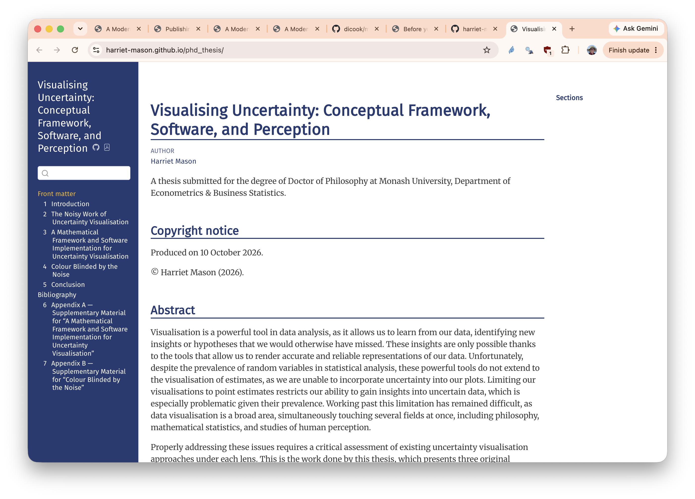{width="100%"}
:::
::: {.column width="40%"}

::: {.f70}
Content like a thesis can also be shared as HTML on a website, in addition to PDF for submission.

Check it yourself by visiting [https://harriet-mason.github.io/phd_thesis/](https://harriet-mason.github.io/phd_thesis/).
:::
:::

:::

## Managing teaching materials

::: {.panel-tabset}

## Private

::: {.column width="60%"}

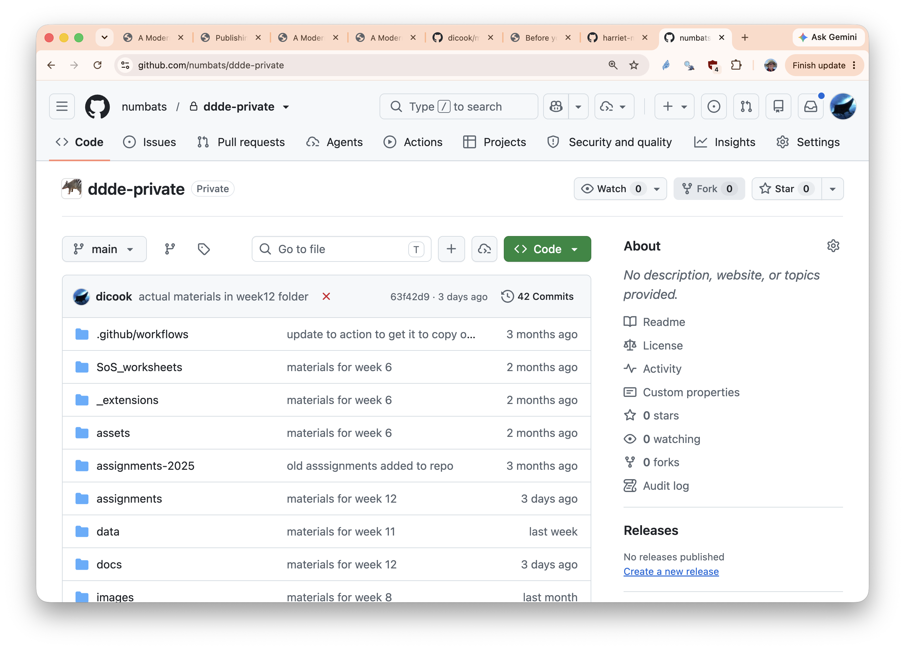{width="100%"}

:::
::: {.column width="40%"}

::: {.f70}
- These are the materials for ETC5521 Diving Deeper into Data Exploration.
- They are stored in an organisation, `numbats`, so if the instructor changes, materials are still available
- All class materials are version controlled, except student marks
- Actively choose what is publicly provided to students

:::
:::

## Public

::: {.column width="60%"}

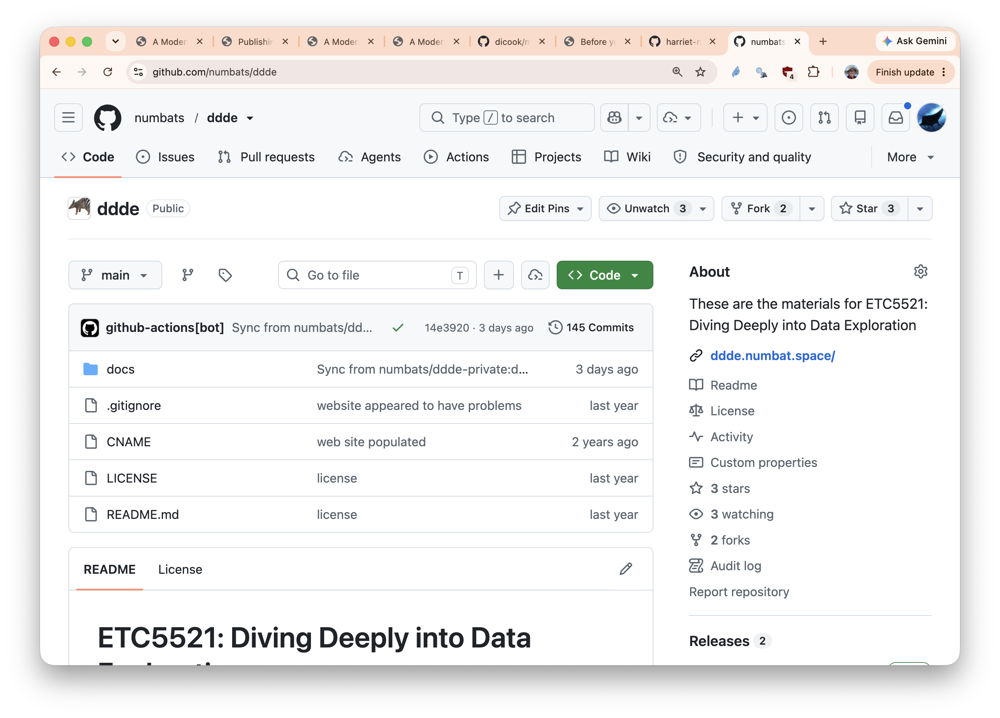{width="100%"}

:::
::: {.column width="40%"}

::: {.f70}
- These are the materials that are provided to students
- They are publicly available, so a licence is shown
- Changes to delivered materials are version controlled, and typically scripted, so that you can see and digest these changes. 
- Errors, or omissions, can even be fixed during a class!
- Demonstrates good data practice to students
- All of the materials are produced using Quarto: slides, assignments, website

:::
:::

## Transfer

::: {.column width="60%"}

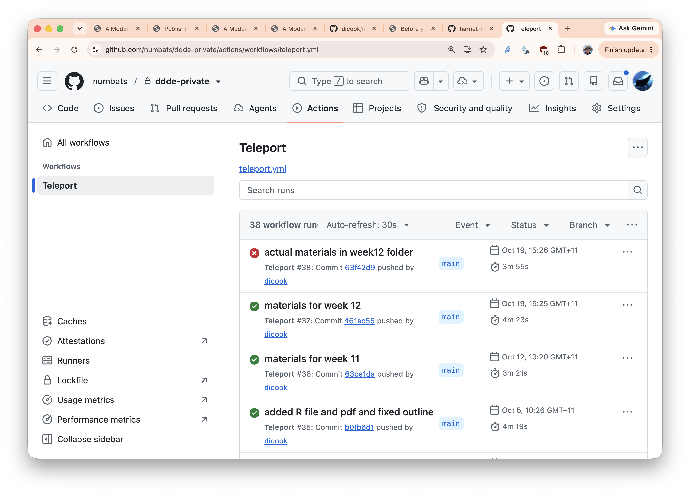{width="100%"}

:::
::: {.column width="40%"}

::: {.f70}
- Materials are transferred to the public repo automatically upon a push to the private repo
- The GitHub Action is called Teleport, written by my colleague Michael Lydeamore
- The class website is in the `docs` folder, which is what gets transferred between repos
- Need to render it locally first (well, I do, so I can check it before pushing to the repo)

:::
:::

## Deploy

::: {.column width="60%"}

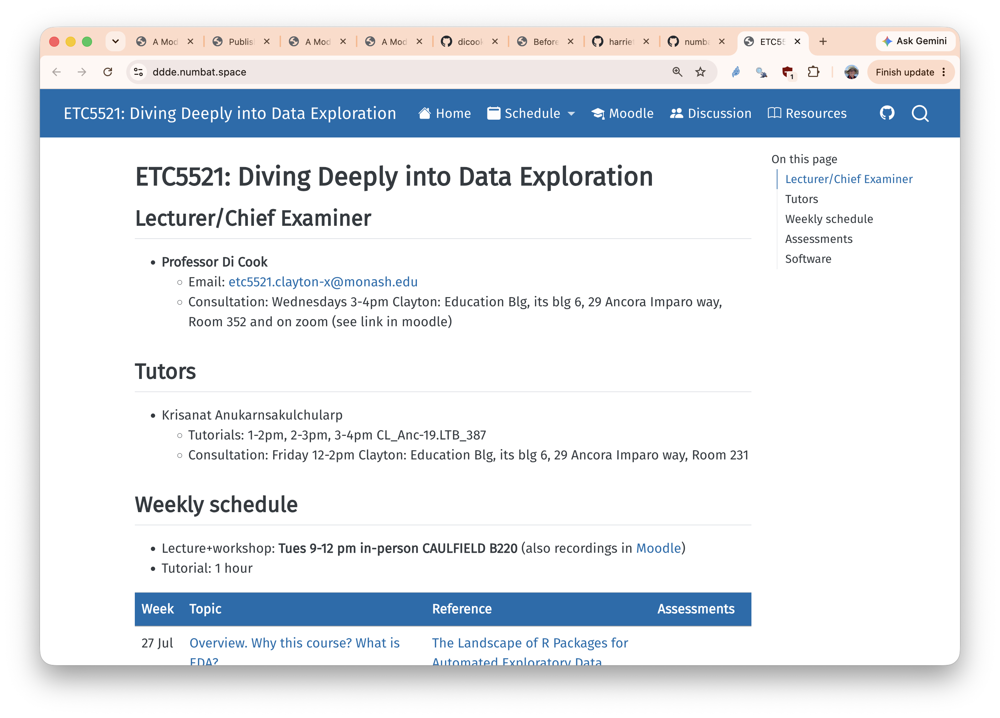{width="100%"}

:::
::: {.column width="40%"}

::: {.f70}
- Website is deployed by GitHub Pages
- Automatically happens when materials are transferred

:::
:::

:::

## Delivering presentations

::: {.column width="60%"}

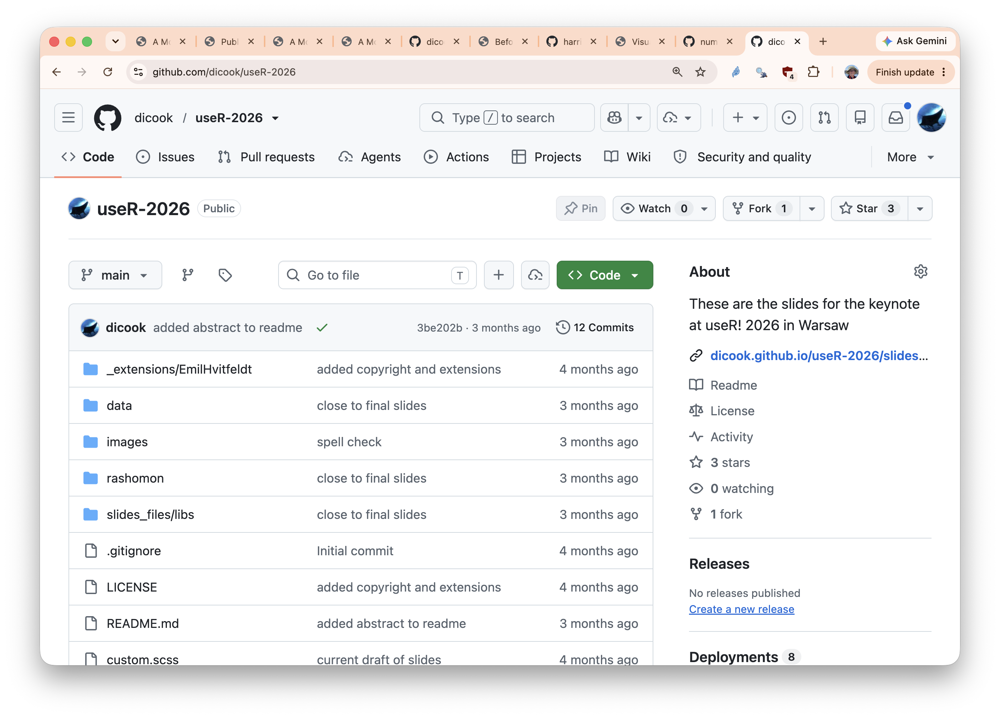{width="100%"}

:::
::: {.column width="40%"}

::: {.f70}

- Much simpler than the last two!
- Create slides, push to repo
- Add the GitHub Pages deploy
- Add a link in the `About` section pointing to the actual `slides.html` file

See [https://github.com/dicook/useR-2026](https://github.com/dicook/useR-2026) as an example.

:::

:::

## What you need open

- Your chosen IDE: RStudio or Positron
- GitHub Desktop, signed in to your GitHub account
- A browser tab at [github.com](https://github.com)

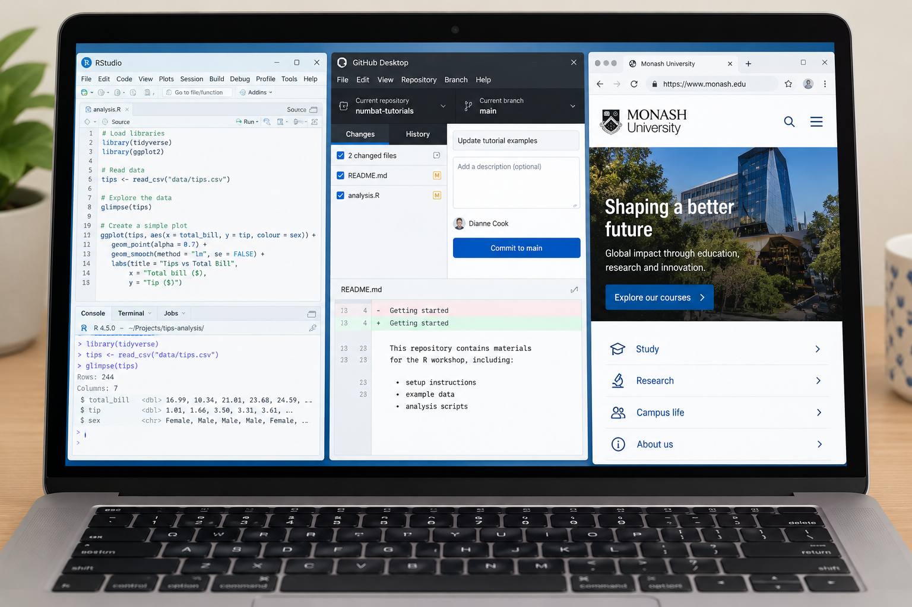

# Structuring a research project {.transition-slide}

## A project is a folder others can open

:::: {.columns}
::: {.column}

::: {.callout-tip .fit-content title="Example structure"}

::: {.f150}

```
my-project/
├── README.md
├── data/
├── scripts/
├── figures/
└── paper.qmd
```
:::

:::

<br><br>

::: {.f60}
[Future you is your first collaborator.]{.rn-fragment rn-type=circle rn-color=#e78c45 rn-strokewidth=3 rn-padding=12}
:::

:::
::: {.column}

::: {.fragment}

Four habits to follow: 

::: {.f80}

1. **folders**: one home for each kind of file, like code, images, data. 
2. **naming**: lowercase, no spaces, dates as `2026-10-19` 
3. **README**: what it is, how to run it, who to ask, how to contribute (if public)
4. **relative paths**: no `setwd()` or `C:/Users/...`

:::

:::
:::
::::

## Relative paths with `here`

```r
# Breaks on every other computer
setwd("C:/Users/me/Desktop/thesis")

# Works if the user is in the same folder structure
dat <- readr::read_csv("data/survey.csv")
```

<br>

::: {.fragment}

`here()` finds the project root, so paths work for co-authors, on a cluster, and when rendering a Quarto document from a subfolder.


```r
# Works anywhere the project is opened
dat <- readr::read_csv(here::here("data", "survey.csv"))
```
:::


# Git basics {.transition-slide}

## The three verbs

::: {.columns}
::: {.column .panel width="30%"}
`commit`

Save a snapshot with a message
:::
::: {.column .panel width="30%"}
`push`

Send commits to GitHub
:::
::: {.column .panel width="30%"}
`pull`

Fetch collaborators' changes
:::
:::

<br><br>

[Good commit messages say *why*:]{.rn-fragment rn-type=circle rn-color=#e78c45 rn-strokewidth=3 rn-padding=12} "Added plot of the missing values".

## Create repository {.activity-slide}

::: callout-tip
## In GitHub Desktop
*File > New Repository*, named `shared-project`
:::

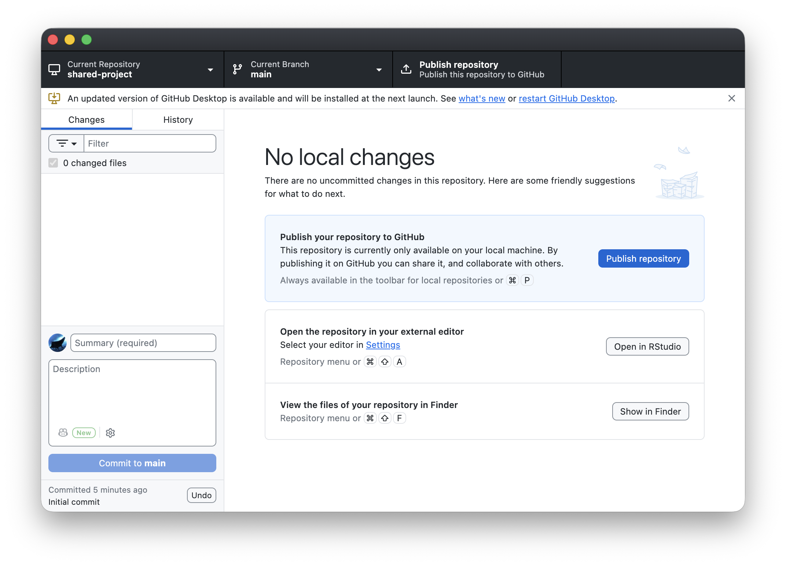{width="100%"}

`r countdown::countdown(2, 0, top = 0, right = 0, font_size = "1.6rem")`

## Build a project skeleton {.activity-slide}

::: callout-tip
## Do this in your IDE's R console

*If you are using RStudio, you need to create a new project (File > New Project) called `shared-project`*

1. Run the code below inside it
2. Open `README.md` and write two lines: what the project is, and how to run it
:::

```r
fs::dir_create(c("data", "scripts", "figures"))
usethis::use_readme_md()
usethis::use_git_ignore(c(".Rhistory", ".RData"))
```

::: {.f60}

Empty folders are not tracked by Git. So the next step is to create some data and a code file. 
:::

::: {.column}
::: {.f60}
1. Using your IDE, *New File*, *R File*, save it into the `scripts` folder as `code.R`
2. Add the code below to this file
3. Run the code to generate a data file
:::
:::
::: {.column}
```{r}
#| eval: false
#| echo: true
library(tibble)
dat <- tibble(x=c(rep("A", 11), 
                  rep("B", 5)), 
              y=rnorm(16))
save(dat, file="data/my-data.rda")
```
:::

`r countdown::countdown(6, 0, top = 0, right = 0, font_size = "1.6rem")`

## First commit {.activity-slide}

::: {.column}

::: callout-tip
## In GitHub Desktop
1. In the `shared-project`, notice the files that should be pushed to the repo (`data`, `scripts`, `README.md`, `shared-project.Rproj`); they should be visible on the left of the window
2. Write a commit message, and **Commit**, then **Push**
3. **Publish repository** (keep it private for now)
:::
:::

::: {.column}
::: {.f60}
::: {.panel-tabset}

## Ready

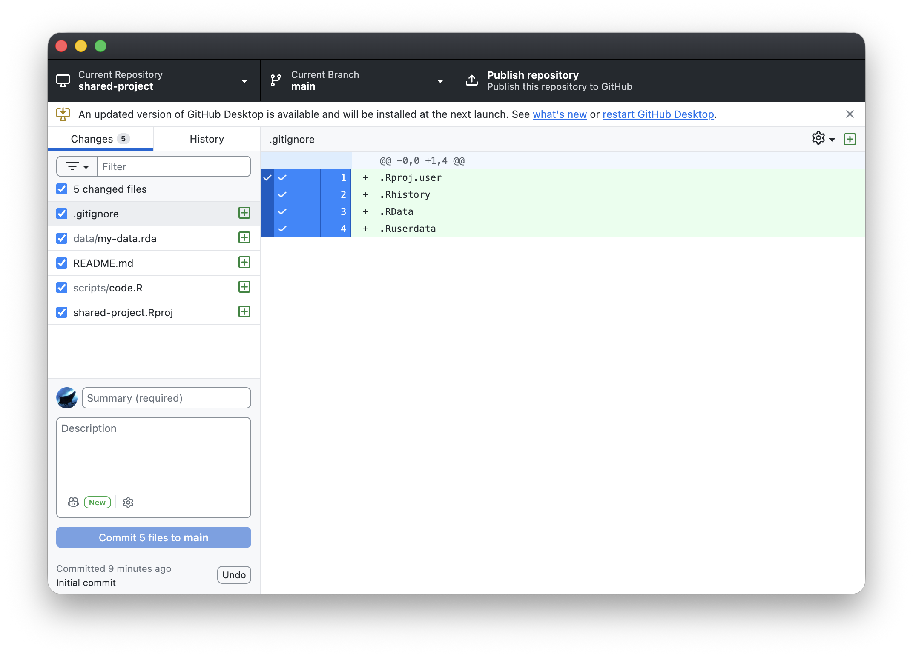{width="100%"}

## Commit

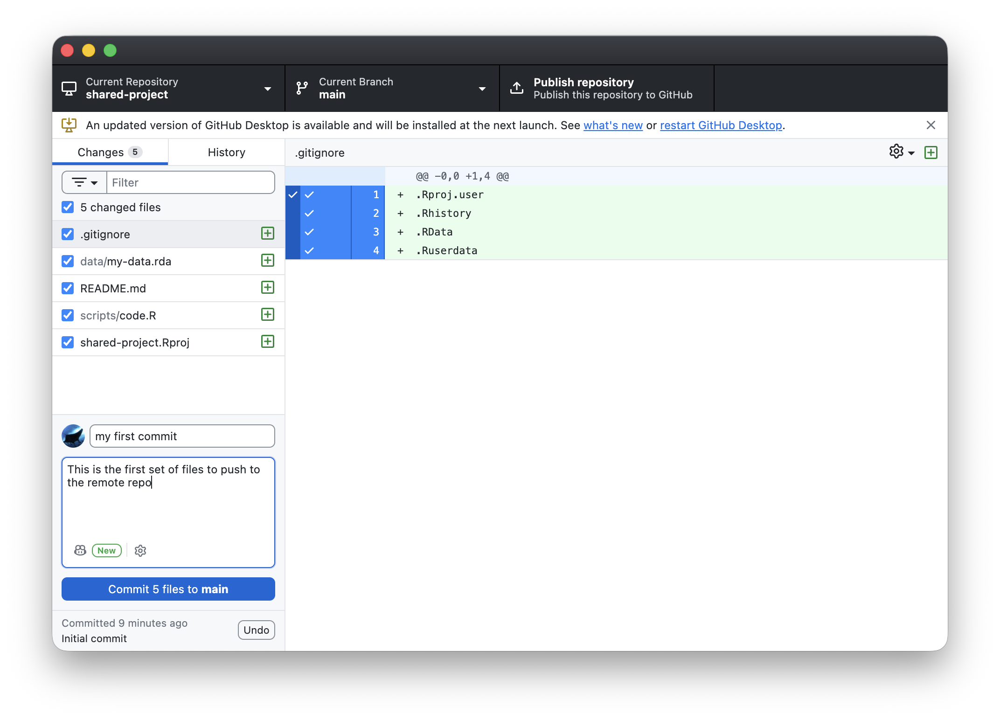{width="100%"}

## Push

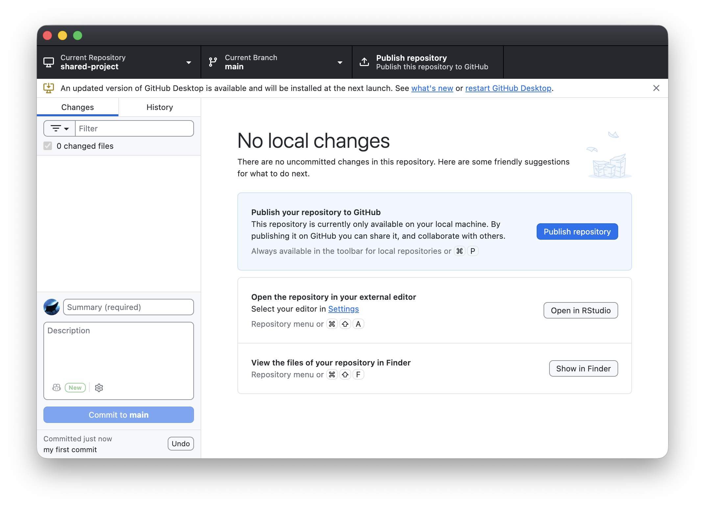{width="100%"}

## Check 

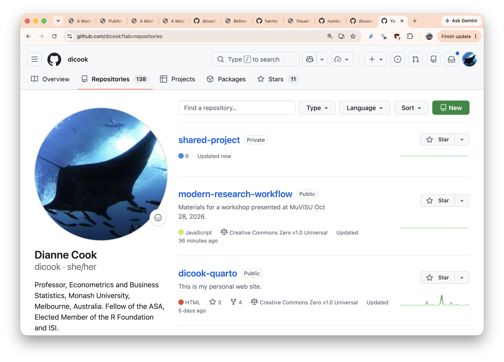{width="100%"}

:::
:::
:::

`r countdown::countdown(4, 0, top = 0, right = 0, font_size = "1.6rem")`


## Share a project with a partner {.activity-slide}

::: callout-tip
## Steps
1. **Owner**: on GitHub, open *Settings > Collaborators* and invite your partner
2. **Partner**: accept the invitation, then **Clone** the repository in GitHub Desktop
3. Both: edit *different* lines of `README.md`, commit, and push
4. Pull each other's work. 
:::

`r countdown::countdown(4, 0, top = 0, right = 0, font_size = "1.6rem")`

## Every time

::: {.column}
Every time you start to work, open GitHub Desktop.

Click on the **Fetch origin** tab.

If there are changes, you will be asked to **Pull origin**.

Do it! It brings the changes to your laptop.

:::

::: {.column}

::: {.panel-tabset}

## Fetch

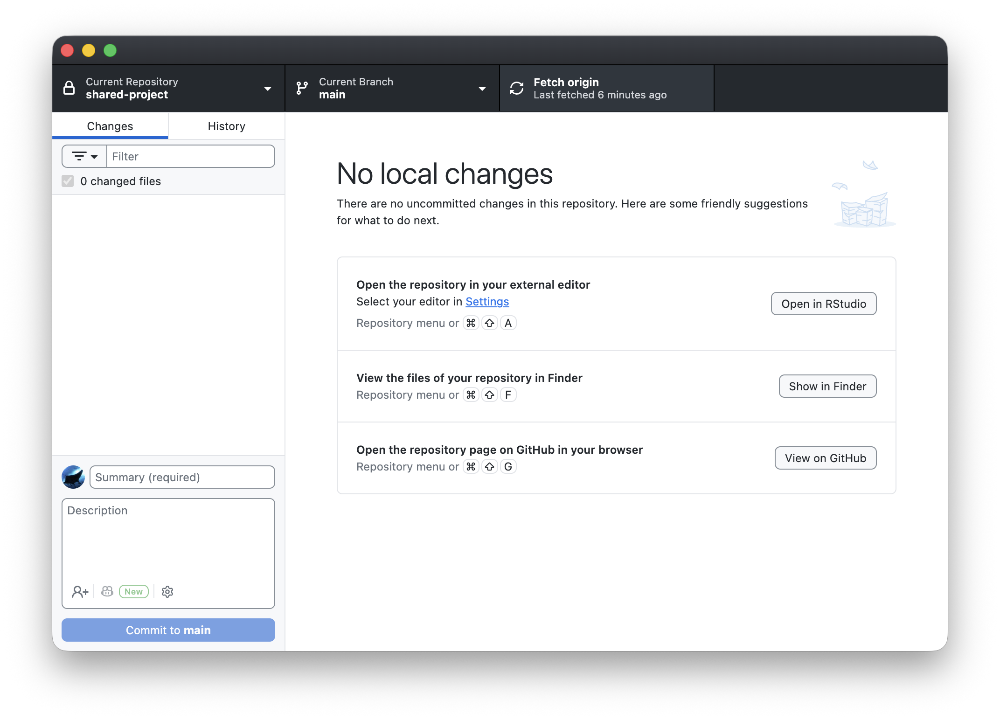{width="100%"}

## Pull

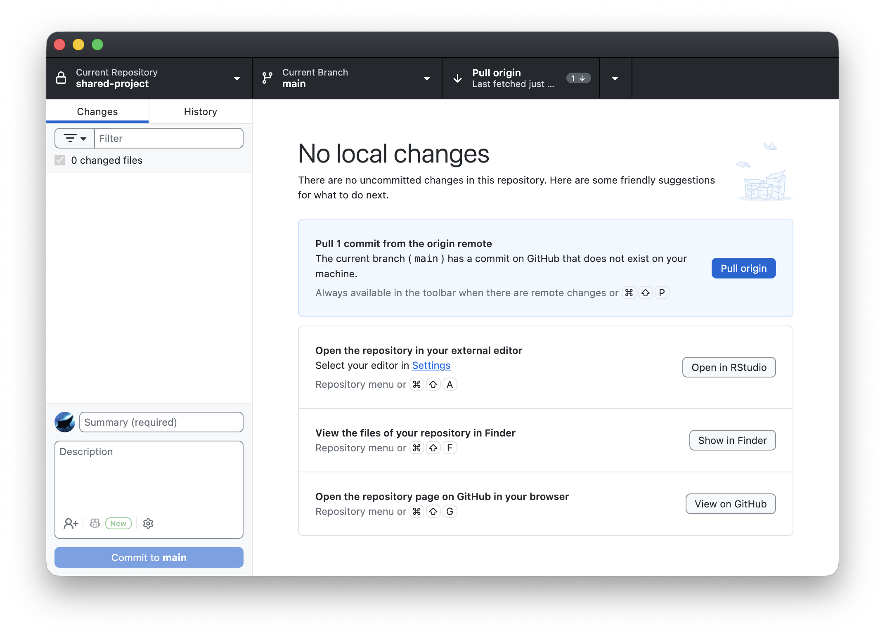{width="100%"}

:::

:::

# Merge conflicts, issues, pull requests, and branches {.transition-slide}

## Merge conflicts

::: {.column}

::: {.f80}
**Most changes are merged automatically by Git.**

Merge conflicts happen when collaborators work on the same part of the project and make contradictory changes, so it is not clear to Git which change should be made.  

[These need to be resolved manually.]{.rn-fragment rn-type=circle rn-color=#e78c45 rn-strokewidth=3 rn-padding=12}
:::
:::
::: {.column}

::: {.f60}
::: {.panel-tabset}

## Notified

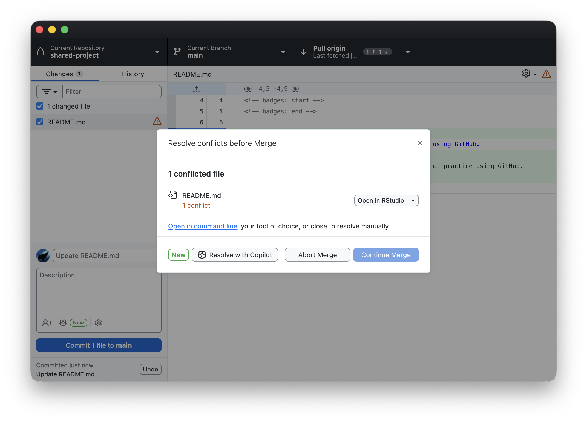

## Conflict

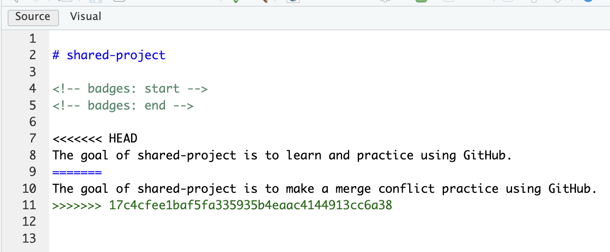

## Resolved

You get two choices, marked by `<<<<<<<`, `=======`, `>>>>>>>`. 

Pick one of them, edit the code, and remove the other choice, plus those marker lines.


:::
:::

:::

## Avoiding conflicts

- Commit and push your changes frequently
- Binary files, like the `pdf` files generated from a `qmd`, may cause conflicts. It's safe to ignore these because the file is regenerated at will.

## Fix a merge conflict {.activity-slide}

::: callout-tip
## Create and fix a conflict

1. On the repo previously shared and edited, you each edit the README.
2. Have your partner push their change.
3. Commit your change, and pull.
4. Fix the conflict, commit and push your version to the repo.

:::

`r countdown::countdown(6, 0, top = 0, right = 0, font_size = "1.6rem")`

## Issues, pull requests, branches

:::: {.columns}
::: {.column .panel .f80 width="30%"}
**Issues**

On your own repo, map out to-dos, provide suggestions, allocate tasks.

On someone else's repo, record a task, bug or idea. Assign it, discuss it, close it.
:::
::: {.column .panel .f80 width="30%"}
**Branches**

Primarily for large projects, where `main` needs to be kept clean and working. New development happens on the branch. 
:::

::: {.column .panel .f80 width="30%"}
**Pull requests**

Merge changes from a branch. 

On someone else's repo, provide a fix for them to review and merge.

A local copy can pull and push to a branch.
:::
::::


## Common pitfalls 

:::: {.columns}
::: {.column .panel}

Large files and GitHub

::: {.f80}

- **50 MB**: GitHub warns you
- **100 MB**: push is blocked, `.gitignore` is a friend
- Deleting a file later does **not** remove it from history
- README or script: **how to download a large data file stored elsewhere**
- Use [Git LFS](https://git-lfs.com/) if you must version big files, but it's not free

:::

:::
::: {.column .panel}

If you accidentally commit a mistake

::: {.f70}

Reverting a commit adds a new commit that undoes the old one, so history stays honest. For uncommitted changes, right-click the file and choose Discard changes.

Nothing committed is ever really lost. You can see the mistake and the fix side by side in the GitHub Desktop History tab.

:::

:::
::::

## Resources

There are many ways to access GitHub from your laptop: the command line, your IDE, GitKraken and more. Git has many more features than we covered, but most research projects only need the basics.

- [Learn GitHub within GitHub](https://learn.github.com/skills): free hands-on lessons
- [Happy Git with R](https://happygitwithr.com) 
- [Learn what is happening under the hood](https://git-scm.com/book/en/v2)


## End of session 1 {.center}

After the break: writing papers and slides with Quarto, and sharing your code.

<a rel="license" href="http://creativecommons.org/licenses/by-nc-sa/4.0/"></a><br />This work is licensed under a <a rel="license" href="http://creativecommons.org/licenses/by-nc-sa/4.0/">Creative Commons Attribution-NonCommercial-ShareAlike 4.0 International License</a>.