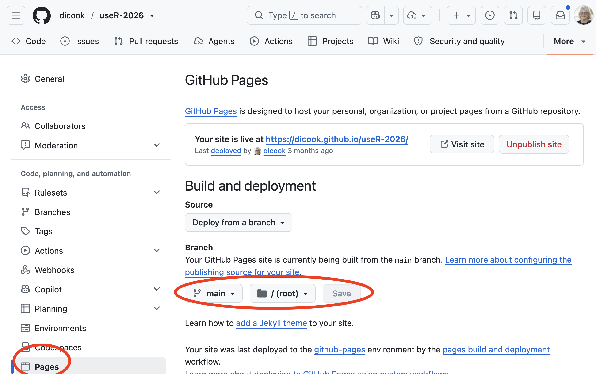
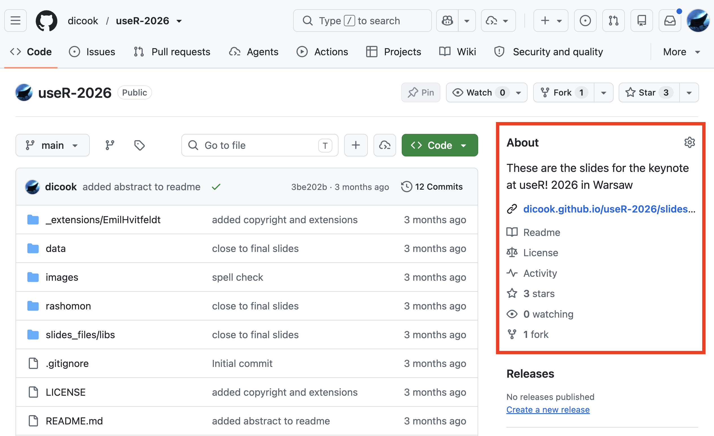

```{r}
#| label: setup
#| include: false
library(countdown)
```

## This session {.smaller}


🕰️ In this session, we will cover:

- Writing with Quarto: papers and slides from one source 
- Citations, journal templates, linking results to code 
- Sharing research code: packaging, licences, citation files, Zenodo 

<br>

There are several short hands-on activities. Keep your `shared-project` from Session 1 open.


<!--
## make sure to include these things

- monash quarto templates
- handling long computations - more for Quarto
- making slides visible from GitHub with Pages
-->

# Writing with Quarto {.transition-slide}

## One source, many outputs

A Quarto file (`.qmd`) holds your **text**, your **code** and your **settings**. Render it to whatever you need.

```text
data/ --> scripts/ --> figures/ --> paper.qmd --> paper.pdf
                                              --> paper.html
                                    slides.qmd --> slides.html
```

Change the data or the analysis, render again, and every figure, number and table updates.

## Anatomy of a Quarto document {.smaller}

````markdown
---
title: "My first reproducible article"
author: "Your Name"
format: html
bibliography: references.bib
---

## Results

Flipper length varied by species [@wickham2016].

```{{r}}
#| label: fig-flippers
#| fig-cap: "Flipper length by species."
library(ggplot2)
ggplot(penguins, aes(species, flipper_len)) + geom_jitter()
```

The mean was `r knitr::inline_expr("round(mean(penguins$flipper_len, na.rm = TRUE), 1)")` mm (@fig-flippers).
````

Three parts: YAML settings at the top, markdown text, and R code chunks. The inline `r` code puts a computed number straight into the sentence.

## Papers and slides from the same work

::: {.columns}
::: {.column width="50%"}
**Choose formats in the YAML**

```yaml
format:
  html: default
  pdf: default
  docx: default
```
:::
::: {.column width="50%"}
**Slides are another format**

```yaml
format: revealjs
```

Headings become slides, so figures and numbers can come from the same scripts.
:::
:::

Hide code in the paper, keep it in the source: `execute: echo: false` in the YAML or in any code chunk.

## Linking results to code

| You write | You get |
|-----------|---------|
| `#| label: fig-flippers` in a chunk | a figure you can refer to |
| `@fig-flippers` | "Figure 1", with a link |
| <code>&#96;r round(x, 1)&#96;</code> | the computed value in your sentence |
| `[@wickham2016]` | a formatted citation |

No copying numbers from output into Word, so no transcription errors.


## Render a document {.activity-slide}

::: callout-tip
## Steps
1. Create `paper.qmd` and `references.bib` in your `shared-project` repo. You can use your IDE to get a starter file **File > New Quarto document**, and choose HTML output.
2. Click **Render**. The HTML appears in the Viewer or your browser.
3. Check: is there a figure, a numbered cross-reference, a citation, and a bibliography at the end?
4. Change the inline calculation to the **median**, render again, and watch the number change.
5. Commit and push `paper.qmd` and `references.bib` in GitHub Desktop.
:::

::: {.f60}
Common problems: package not installed, wrong working folder (use here::here() for data), or missing blank lines around the chunk. Penguins needs R 4.5.0 or newer.
:::

`r countdown::countdown(6, 0, top = 0, right = 0, font_size = "1.6rem")`

# Citations and journal templates {.transition-slide}

## Citations

- Keep references in a **`.bib` file** (export from Zotero, EndNote or Mendeley)
- `[@key]` cites in brackets, `@key` cites in the sentence
- Switch style with a **CSL file**: `csl: journal.csl` ([Zotero style repository](https://www.zotero.org/styles))
- To find appropriate citations of **R and packages** you used for your work:

```r
toBibtex(citation())            # R itself
toBibtex(citation("ggplot2"))   # a package
```

[Always cite the software used for your work]{.rn-fragment rn-type=circle rn-color=#e78c45 rn-strokewidth=3 rn-padding=12}

## Journal templates

Many journals have a ready-made Quarto format. One command gives you a starter article:

```bash
quarto use template quarto-journals/jasa
```
::: {.f60}
Quarto asks whether you trust the authors of the template. Say yes for quarto-journals. Templates approximate the journal look, so always check the journal's author guidelines before submitting.
:::

[Notice that this will create the folder `_extensions` in your `shared-project`]{.f70}

<br>

::: {.fragment}

::: {.f80}

- More templates at [github.com/quarto-journals](https://github.com/quarto-journals)
- Authors and affiliations are written **once** in the YAML
- Change journal by changing the format, for example `jss-pdf`
- PDF output needs LaTeX (e.g. TinyTeX from setup). 
:::

:::

## Try a journal template {.activity-slide}

::: callout-tip
## Steps
1. Open a **Terminal** (RStudio: **Tools > Terminal > New Terminal**) in your `shared-project` folder
2. Run `quarto use template quarto-journals/jasa`. Answer **Y** to trust the authors, and give the folder a name such as `elsevier-paper`
3. Open the `.qmd` file in the new folder and click **Render**
4. Replace one sentence with your own, with a citation from your `references.bib`
:::

::: {.f60}
The repo [https://github.com/dicook/paper-example](https://github.com/dicook/paper-example) has a starter pack, if needed.
:::

`r countdown::countdown(5, 0, top = 0, right = 0, font_size = "1.6rem")`

## Monash Quarto templates

[Monash Quarto templates](https://github.com/quarto-monash) has a nice collection of templates:

- thesis
- slides
- unit website
- letter
- memo
- consulting report

These can be adapted for other institutions.

## Slow code chunks

:::: {.columns}
::: {.column .f70}

Save the slow result to a file. Only run the code if the file is missing.

```r
#| label: slow-model
model_file <- here::here("data", "processed", "model.rds")

if (!file.exists(model_file)) {
  model <- fit_slow_model(dat)   # takes 20 minutes
  saveRDS(model, model_file)
} else {
  model <- readRDS(model_file)
}
```

- First render: slow. Every render after: instant
- **Rerun on purpose** by deleting the file
- Big result files go in `.gitignore`, so others regenerate them

:::
::: {.column}

::: {.fragment .f50}

Other ways to handle slow chunks

| Approach | How | Watch out for |
|----------|-----|---------------|
| **Separate script** | Run `R/01-fit-model.R` once, saving results. The document only reads them | Must remember to rerun the script |
| **Chunk cache** | `#| cache: true` on the chunk | Reruns when the chunk code changes, but not when an input file changes |
| **Freeze** | `execute: freeze: auto` in `_quarto.yml` | Applies to Quarto projects such as websites and books |
| **Pipeline tool** | The `targets` package | Extra learning, but it tracks what is out of date for you |

:::

:::
::::

# Slides {.transition-slide}

## Sharing through GitHub pages

:::: {.columns}
::: {.column}
Make the repo **public**, then:

::: {.f70}

1. **Settings > Pages**
2. Source: **Deploy from a branch**
3. Branch **main** (and possibly folder **/docs**)
4. **Save**

Your site is live

::: {.f80}
`https://username.github.io/repo-name/`
:::

Add this information to the **About** block.

By default the README.md is turned into a website. If `index.html` exists, this will be used.
:::

:::
::: {.column}

::: {.panel-tabset}

## Pages



## About


:::

:::
::::

## Publish your shared project {.activity-slide}

::: callout-tip
## On GitHub, for your `shared-project` repo (owner only)

1. **Settings > General**, scroll to the *Danger Zone*, and **Change visibility** to **Public**
2. **Settings > Pages**: deploy from branch **main**, folder **/ (root)**, then **Save**
3. Wait a minute, then refresh the Pages settings to get the link
4. Visit `https://username.github.io/shared-project/` and check that your README is showing
5. Add the link to the repo's **About** block
:::

::: {.f60}
There is no `index.html` yet, so GitHub turns your `README.md` into the home page. It's simple, but the same steps publish slides or a thesis.
:::

`r countdown::countdown(3, 0, top = 0, right = 0, font_size = "1.6rem")`

# Sharing research code {.transition-slide}

## Make a package when

:::: {.columns}
::: {.column width="50%"}

::: {.f80}

- others will use your methods 
- you want reuse your functions
- there is a need for documentation and tests
- `install` to just work for anyone

:::

:::
::: {.column width="50%"}

Package folder structure

```text
mypackage/
├── DESCRIPTION     
├── NAMESPACE       
├── R/              
├── man/ 
├── data/               
├── tests/testhat/ 
├── vignettes/         
└── README.md
```

<br>

```r
usethis::create_package("~/mypackage")
usethis::use_r("my-function")
devtools::document()
devtools::check()
```

:::
::::

## More details

:::: {.columns}
::: {.column width="45%"}

[No licence means nobody else may legally reuse your code.]{.f70} **Choose a licence.**

::: {.f60}

| What | Choice |
|------|---------------|
| Permissive licenses are very easy going | MIT or Apache 2.0 |
| Code, derived work must also use this | GPL |
| Other work | CC BY 4.0 |
:::

::: {.f50}

[choosealicense.com](https://choosealicense.com) explains each option in plain language.
:::

:::
::: {.column width="55%"}

::: {.fragment}

**Organising** `R/`

::: {.f70}
- **One function per file**, or a few closely related ones
- File name matches the function: `group_means()` lives in `group_means.R`
- Small helpers go together in `utils.R`
- Group related files with a prefix: `plot_scatter.R`, `plot_bar.R`
- Keep files short enough to find things quickly
:::

::: {.f60}
Analysis scripts and the paper do **not** go in `R/`. Keep them in a separate folder such as `analysis/`, and list it in `.Rbuildignore`.
:::

:::
:::
::::

## Start a package {.activity-slide}

::: {.callout-tip .fit-content title="Follow these steps"}

::: {.f80}

1. In GitHub Desktop, *File > New Repository*, named `mypackage`
2. In your IDE, use `usethis::create_package("~/mypackage")` and `usethis::use_r("my-function")` to start your package. 
3. Write a function in the `my-function.R` file, e.g.
```
my_function <- function(x) {
  length(x)
}
```
4. In RStudio, put your cursor inside the function and choose **Code > Insert Roxygen Skeleton**. Complete some basic description of your function
5. Add a license `use_mit_license()`.
6. Edit the DESCRIPTION file to list you as the author.
7. Add a citation using `use_citation()`. (It needs editing, to do later.)
8. Use `devtools::document()`, `devtools::check()` and `devtools::install()` to make documentation, check package structure and install it. 
9. **Commit** and **push** in GitHub Desktop to publish it to a **public** repo.
10. Check that your partner can install it by running `pak::pak(YOURUSERNAME/mypackage)`
:::
:::

`r countdown::countdown(8, 0, top = 0, right = 0, font_size = "1.6rem")`

## Where can your package live?

::: {.f70}

| Repository | Install with | Best for |
|------------|--------------|----------------------------|
| **CRAN** | `install.packages("pkg")` | General R packages. Automated checks, the widest reach |
| **Bioconductor** | `BiocManager::install("pkg")` | Genomics and bioinformatics |
| **R-universe** | `install.packages("pkg", repos = "https://user.r-universe.dev")` | Packages from GitHub, with no submission process |
| **GitHub** | `pak::pak("user/repo")` | Development versions and early sharing |

:::

## Resources

- Main [Quarto](https://quarto.org) documentation
- [Quarto gallery](https://quarto.org/docs/gallery/)
- [Journal templates](https://quarto.org/docs/journals/) and also [ANZJS](https://github.com/emitanaka/quarto-anzjs)
- [Monash Quarto templates](https://github.com/quarto-monash)
- [The Turing Way](https://book.the-turing-way.org) general advice on modern research practice
- [R packages (2e)](https://r-pkgs.org/) by Wickham and Bryan

## End of session 1 {.center}

After the break: AI in the research workflow, and data visualisation.

<a rel="license" href="http://creativecommons.org/licenses/by-nc-sa/4.0/"></a><br />This work is licensed under a <a rel="license" href="http://creativecommons.org/licenses/by-nc-sa/4.0/">Creative Commons Attribution-NonCommercial-ShareAlike 4.0 International License</a>.

<!--

## Objectives {.smaller}

By the end of this session you will be able to:

- list several **outlets** for publishing software
- understand the **benefits** of publishing a software paper
- identify the **components** of a well-constructed software article
- **draft** a paper plan and cover letter for your own software

# Why publish software as an article? {.transition-slide style="align: center;"}

## What is a software article?

An academic publication whose primary subject is a piece of software. Instead of reporting a scientific finding, it typically describes:

- **What it does**: the problem it solves and where it fits among existing tools
- **How it works**: the methods, algorithms or models it implements
- **How to use it**: installation, basic interface, a worked example
- **Why it matters**: the gap it fills, the intended users, how it differs from alternatives
- **Availability**: where the code lives (CRAN, GitHub), licence, how to cite it

## Benefits to the community

::: {.f70}

1. **Discoverability**: indexed journals (Scopus, Google Scholar) surface your tool to people searching by topic or method, not by package name
2. **Peer-reviewed vetting**: CRAN checks and CI show the code runs, but not that the methods are sound
3. **Structured comparison**: papers must situate the tool among alternatives
4. **Faster adoption and trust**: a peer-reviewed paper signals quality to potential users
5. **Documentation that outlives the maintainer**: READMEs and vignettes vanish with a repository, a published paper is archived with a DOI

:::

. . .

**Why not supplementary material?** It is not indexed, not independently citable, lightly reviewed, and tied to one study's lifecycle.

::: notes
4 min across this and the previous slide.
:::

## Common outlets

::: {.panel-tabset}

## Outlets

- [Journal of Statistical Software](https://www.jstatsoft.org/index)
- [The R Journal](https://journal.r-project.org)
- [Journal of Open Source Software](https://joss.theoj.org)

Many domain-specific journals have a software section, for example:

- [Genome Biology](https://link.springer.com/journal/13059/volumes-and-issues/27-1)
- [Methods of Ecology and Evolution](https://besjournals.onlinelibrary.wiley.com/toc/2041210x/current) 
- [Royal Society Open Science](https://royalsocietypublishing.org/rsos)
- [Applications in Plant Sciences](https://bsapubs.onlinelibrary.wiley.com/journal/21680450)

## Comparison

::: {style="font-size: 70%"}

| Criterion         | JSS                        | The R Journal              | JOSS                           |
|--------------------|----------------------------|------------------------------|---------------------------------|
| Scope              | Any statistical software  | R only                      | Any research software          |
| Length             | Long (full paper)         | Medium-long                     | Very short                     |
| Review focus       | Methodology + code        | Package quality + writeup   | Codebase (tests, docs, license) |
| Output format      | PDF only                  | Native HTML (+ PDF)         | PDF (via Markdown/GitHub)      |
| Interactive figures| Not supported             | Supported (native HTML)     | Not part of the paper itself   |
| Impact factor      | High               | Moderate, variable        | None by design                 |
| Time to publish    | Slower, thorough           | Moderate                    | Often fast if code is ready    |
| Best fit           | Novel/complex method       | Solid, R-specific package   | Working, well-engineered tool  |

:::

:::

::: notes
3 min. Point out that the right outlet depends on the stage of the software and how novel the method is.
:::

## Your turn {.activity-slide}

Compare and contrast [these articles](https://docs.google.com/spreadsheets/d/1MFhmUNudJc9VQOVwIEqY80Geoi7EauguCemK9-6oBfk/edit?usp=sharing). **Work in pairs, take one article each, then swap notes.**

::: {.f70}

- JSS: [Wickham (2011) The Split-Apply-Combine Strategy for Data Analysis](https://www.jstatsoft.org/article/view/v040i01)
- R Journal: [Ayala et al (2023) asteRisk - Integration and Analysis of Satellite Positional Data in R](https://journal.r-project.org/articles/RJ-2023-023/)
- JOSS: [Graesser et al (2026) GeoWombat: Scalable geospatial and remote sensing analysis in Python](https://joss.theoj.org/papers/10.21105/joss.10812)
- Genome Biology: [Holt et al (2026) Aardvark: sifting through differences in a mound of variants](https://link.springer.com/article/10.1186/s13059-026-04165-0)

:::

Glance through and note:

::: {.f70}

- How long is it? Sketch the paper structure
- How much detail about the software? Any code fragments?
- Is there an application section? Figures or a flow chart?
- Is there a comparison with other software?
- Format (PDF, HTML), links to source, supplementary material

:::

`r countdown::countdown(7)`

# What goes into an article about software? {.transition-slide style="align: center;"}

## Anatomy of a software article

::: {style="font-size: 75%"}

| Section | Answers | In our examples |
|---------|---------|-----------------|
| **Problem and motivation** | Why write it? Why don't existing tools do the job? | All four open with the problem and the existing landscape |
| **Key features** | What does it do? | JSS uses tables and illustrations, R Journal sections match the package components |
| **Design and implementation** | How does it work? | JOSS requires a software design section, Genome Biology puts it in Methods, JSS and R Journal are mostly user-facing |
| **Examples and applications** | Does it work? How is it used? | JSS has two worked examples, R Journal weaves examples into the text, Genome Biology benchmarks against other tools |
| **Availability** | Where is it, under what licence, how do I cite it? | Links to package source and archive |

:::

::: notes
3 min. Different journals weight these sections differently, so read the author guidelines of your target outlet first.
:::

## Opening with the problem

::: {.panel-tabset}

## JSS

> What do we do when we analyze data? What are common actions and what are common mistakes? Given the importance of this activity in statistics, there is remarkably little research on how data analysis happens. This paper attempts to remedy a very small part of that lack by describing one common data analysis pattern: Split-apply-combine. 

## R Journal

::: {.f80}

> Planning the launch, operation and orbital maneuvers of satellites requires predictions of the trajectory that a satellite will follow along time from a known state vector...

> We introduce asteRisk, an R package that aims to provide a suite for astrodynamics analysis in R...

:::

## JOSS

::: {.f80}

> Satellite remote sensing has become essential for environmental monitoring, agriculture, disaster management, and land use analysis... yet the Python ecosystem for processing this data remains fragmented.

:::

:::

## Showing the software

::: {.panel-tabset}

## JSS: explain with visuals

Re-organising and summarising data, shown using tables and a conceptual illustration.

:::: {.columns}
::: {.column}

:::
::: {.column}
{width=600}
:::
::::

## Genome Biology: compare with others

Results illustrate features of the software while comparing it with current tools.

:::: {.columns}

::: {.column}
{width=80%}
:::

::: {.column}
{width=100%}
:::

::::

:::

::: notes
4 min across these two slides.
:::

## Place your software in context

- Don't reinvent the wheel, **stand on the shoulders of others**
- Review existing tools in your introduction, and use them as a springboard or benchmark throughout the paper
- Identify clearly what extra value _your_ software adds

. . .

**Guide your reader with a conceptual diagram.** The software may make sense in your head, but a first-time user needs a hand to understand the problem landscape, the rationale and the design solution.

::: notes
3 min. Show a conceptual diagram from one of the earlier articles if time allows.
:::

## Your turn {.activity-slide}

**Map out your paper.** Choose one of your own software projects, or one of our examples.

1. Find one existing tool to compare with. Note key differences in design, implementation, usability and application
2. Write a couple of sentences each for:

    - motivation
    - design and implementation
    - usage
    - application

3. If time, sketch a conceptual diagram: the problem it solves, the workflow, the algorithm, or a use case

`r countdown::countdown(8)`

# Supporting and publishing your software {.transition-slide style="align: center;"}

## Supporting your software

::: {.columns}
::: {.column width="50%"}

**Where it lives**

- Version-controlled source code: GitHub or GitLab
- Place to download: CRAN, Bioconductor, r-universe
- Releases: semantic versioning, `DESCRIPTION`, a GitHub release, `NEWS.md`

**Portability**

- Ask friends to install and try it
- GitHub Actions or rhub across operating systems and R versions
- Distribution through an archive such as CRAN

:::
::: {.column width="50%"}

**Helping people use it**

- [Unit tests](https://testthat.r-lib.org/)
- Example datasets
- Documentation: help files for each function, vignettes ("Getting started", "Case study"), cheatsheets or video walkthroughs
- Branding, such as a hex sticker

:::
:::

::: notes
3 min. This builds directly on the GitHub material from Session 1.
:::

## Publishing best practices

::: {.columns}
::: {.column width="50%"}

**Collaboration and reproducibility**

- Keep the paper in a GitHub repository
- Use R Markdown or Quarto with journal templates
    - [R Journal: rjtools](https://rjournal.github.io/rjtools/)
    - [JSS Quarto template](https://github.com/quarto-journals/jss)
    - [Other article types](https://quarto.org/docs/journals/formats.html)

**Accessibility**

- Add alt text to figures

:::
::: {.column width="50%"}

**Big, slow or private data**

- Don't store the data in your R package
- Use Apache Parquet files, DuckDB, or query the API that holds your data
- For private data, share a simulated or small example

**Submission**

- Write a clear cover letter

:::
:::

::: notes
3 min.
:::

## Your turn {.activity-slide}

**Write a cover letter** for your software that covers:

- Problem statement: the knowledge gap your software fills
- Audience: the intended user
- Design features and highlights
- Impact: is it easier, more accessible, more accurate, or does it give additional insight compared with what exists?

`r countdown::countdown(5)`

# Summary

- Compared common outlets for publishing software, though domain-specific ones may suit you better
- Outlined the key sections of a software article
- Placed your software among existing tools and planned a conceptual diagram
- Covered supporting your software and publishing best practices
- Drafted a cover letter for submission

## End of session 2 {.center}

<a rel="license" href="http://creativecommons.org/licenses/by-nc-sa/4.0/"></a><br />This work is licensed under a <a rel="license" href="http://creativecommons.org/licenses/by-nc-sa/4.0/">Creative Commons Attribution-NonCommercial-ShareAlike 4.0 International License</a>.

-->